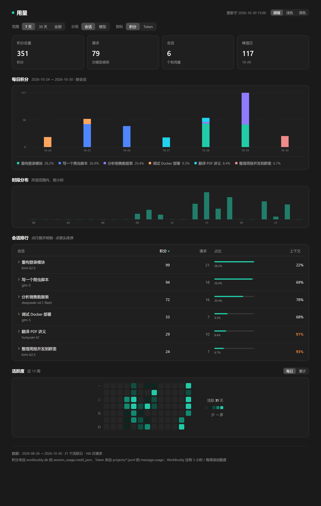
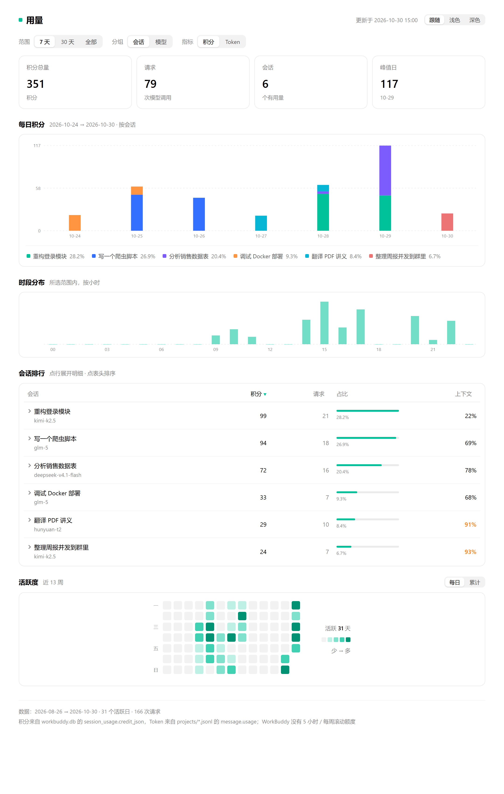

# workbuddy-usage

A local, interactive usage dashboard for [WorkBuddy](https://www.workbuddy.cn/): credits **and** tokens per day, per session, per model — the kind of usage panel WorkBuddy itself doesn't ship.

WorkBuddy 本地用量看板：积分和 token 两个维度，按天 / 会话 / 模型拆开看。WorkBuddy 自己只有积分明细列表，没有图。

**[Live demo (sample data)](https://wazixuan.github.io/workbuddy-usage/)**

| Dark | Light |
|---|---|
|  |  |

<sub>Screenshots use made-up sample data (`--demo`).</sub>

## What you get

One self-contained HTML file (hand-written SVG + vanilla JS, no CDN, works offline), styled with WorkBuddy's own design tokens so it looks at home in the app:

- `7d / 30d / all` range switch — metrics, charts and table all recompute
- `credits / tokens` switch for the whole page
- Daily stacked bars, grouped by `session` or `model`; hover for the day's top sessions; click the legend to hide a series
- Hour-of-day distribution
- Session ranking — sortable by credits / requests / context usage; expand a row to see every request
- Context-window usage per session (turns orange at ≥ 80 %)
- 13-week activity heatmap, `daily / cumulative`
- Light and dark themes that follow WorkBuddy (see below)

## Requirements

- WorkBuddy installed and used on this machine (reads `~/.workbuddy`)
- Python 3.8+ (standard library only)

## Install

As a WorkBuddy skill, so you can type `/wb-usage` inside WorkBuddy:

```bash
git clone https://github.com/WaziXuan/workbuddy-usage ~/.workbuddy/skills/wb-usage
```

Restart WorkBuddy once and the `/wb-usage` command appears. Or just run the script directly from anywhere.

## Usage

```bash
python wb_usage.py            # build ~/wb-usage/dashboard.html and print a summary
python wb_usage.py --open     # build and open it in the browser
python wb_usage.py --out DIR  # different output folder (or set WB_USAGE_OUT)
python wb_usage.py --publish  # also upload it to your WorkBuddy 资料库 (Library)
python wb_usage.py --demo --open   # try it with made-up data, no WorkBuddy needed
```

### Light / dark

Colors come from WorkBuddy 5.9's design tokens (its "IDE Light" and "IDE Night" themes: `#1a1a1a` page, teal `#00c29a` brand, the same text and border alphas). The page picks a theme in this order:

1. `?theme=light` or `?theme=dark` in the URL
2. The 跟随 / 浅色 / 深色 switch on the page (remembered in the browser)
3. Your WorkBuddy appearance setting, read when the dashboard is built (`~/.workbuddy/storage/user-*/global/preferences.json`)
4. The system light/dark setting, if WorkBuddy is set to follow the system

`--theme light|dark|system` overrides step 3.

### Put it in the WorkBuddy Library (资料库)

`--publish` uploads the dashboard as a page in your personal Library space, so it sits in WorkBuddy's sidebar. The first run creates the page; later runs overwrite **the same page** (its id is kept in `<out>/library.json`), so you never get duplicates.

It goes through WorkBuddy's built-in Library skill and the app's local IPC channel, so **WorkBuddy must be running** and logged in. Nothing else is uploaded anywhere.

### Refresh it on a schedule (Windows)

```powershell
.\schedule.ps1                      # daily at 08:00 and 23:00, with --publish
.\schedule.ps1 -Times 22:30         # pick your own times
.\schedule.ps1 -Remove              # delete the task
```

Runs windowless via `pythonw.exe`; output is appended to `<out>/daily.log`. On macOS / Linux, a cron line does the same:

```cron
0 8,23 * * * python3 ~/.workbuddy/skills/wb-usage/wb_usage.py --publish --log ~/wb-usage/daily.log
```

## How it works

| Source | What it gives |
|---|---|
| `workbuddy.db` → `session_usage.credit_json` | credits per request (`{requestId: credits}`) |
| `workbuddy.db` → `session_usage.used / size` | context-window usage |
| `workbuddy.db` → `sessions` | session titles, models |
| `audit-log/*.jsonl` | timestamps per request |
| `projects/*/*.jsonl` → `message.usage` | tokens, joined on `providerData.conversationRequestId` |

`session_usage` only keeps the latest snapshot per session, so every run merges what it sees into `<out>/history/YYYY-MM-DD.json` (deduplicated by request id). History builds up from the first run — run it regularly (see the schedule above) and the heatmap fills in over time.

## Limits

- WorkBuddy bills in credits on a plan, with no rolling 5-hour / weekly limits, so there are no "% of limit" numbers.
- Tokens exist only for sessions whose local transcripts are still on disk.
- About a quarter of requests have no audit-log timestamp; those fall back to the session's last update time, so their day can be slightly off (totals are unaffected).
- Built against WorkBuddy 5.9.x; a future version may change these files.

All reads are read-only. Your usage data stays on your machine unless you use `--publish`.

## License

MIT
